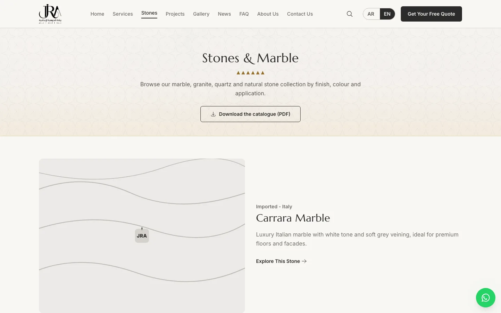
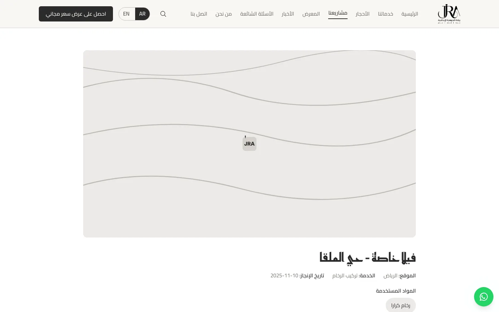
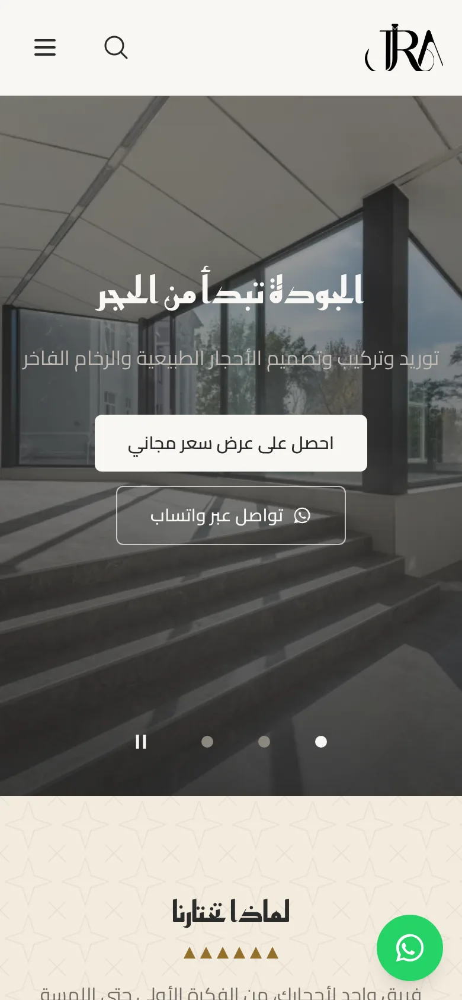
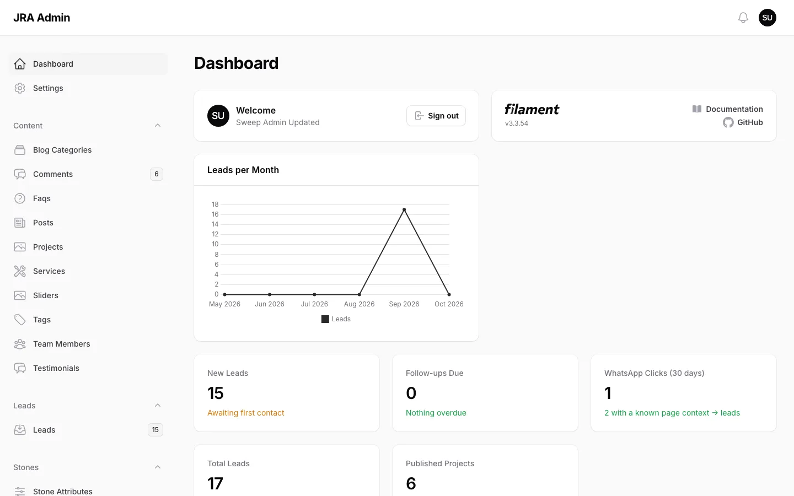

# Riyadat Al-Jawhara · ريادة الجوهرة الإبداعية

**Bilingual (Arabic / English) website and admin platform for a natural stone, marble and granite company in Saudi Arabia.**

[](https://github.com/m77mdabdo/riyadat_al_jawhara/actions/workflows/ci.yml)


| Home (Arabic) | Home (English) |
|---|---|
|  |  |
| **Stone catalogue** | **Project page** |
|  |  |
| **Mobile** | **Admin dashboard** |
|  |  |

<sub>Screenshots use demo data.</sub>

---

## About

Riyadat Al-Jawhara Al-Ibdaeya supplies and installs marble, granite, quartz and natural stone for residential and commercial projects across Saudi Arabia. This platform is the company's website and back office in one:

- **Presentation:** services, the stone catalogue and the project portfolio, in Arabic (right-to-left) and English.
- **Catalogue:** every stone with its specifications, gallery, related projects and a downloadable PDF spec sheet.
- **Portfolio:** completed projects with before/after comparisons and the materials used.
- **Lead generation:** quote requests and WhatsApp clicks captured with their context, followed up by the team in the admin panel.

## Features

**Public site**
- Home page with hero slides, services, stone categories, featured projects, process, statistics (only when real figures are set), testimonials and FAQ.
- Services, stones, projects, gallery, blog (categories, tags, moderated comments), FAQ, about, contact, privacy policy and terms.
- Site-wide search across services, stones, projects, posts and FAQs, in both languages.

**Catalogue and filters**
- Filter stones by category, finish, colour, application and origin (local / imported).
- Downloadable catalogue PDF and per-stone spec sheets, in Arabic (correctly shaped, RTL) and English.

**Portfolio**
- Filter projects by service, stone and sector; before/after slider; lightbox gallery; similar projects.
- A project's client name is shown only when that client has agreed.

**Leads and CRM workflow**
- "Request a quote" buttons pre-fill the service, stone or project the visitor was viewing.
- Lead status pipeline, assignee, follow-up dates, internal notes, follow-ups-due filter and CSV export.
- WhatsApp button clicks are counted; clicks from a service, stone or project page also create a lead.

**Notifications**
- Branded HTML + plain-text emails in Arabic and English: new lead (team), confirmation (visitor), daily follow-up digest, comments awaiting review, admin password reset.
- In-panel notification bell. Every email is queued and retried; a mail problem never breaks a visitor's request.
- Admin "Email previews" page and `app:mail-test` for checking every template.

**Bilingual / RTL**
- Every page under `/ar/…` or `/en/…` (Arabic is the default), with a language switch that keeps the current page.
- Full RTL layout, Arabic typography (Cairo + Reem Kufi), English typography (Inter + Marcellus).
- Arabic or English admin panel, chosen per user.

**SEO**
- Canonical URLs, hreflang, Open Graph and Twitter cards, JSON-LD (LocalBusiness, Article, BreadcrumbList, FAQPage).
- Per-page title/description overrides, bilingual `/sitemap.xml`, dynamic `/robots.txt`.

**Admin panel and roles**
- Filament admin for all content, leads, settings, users and the activity log (who changed what).
- Two roles: admin and editor (see the matrix below).

**Security**
- Content Security Policy and security headers, rate limits on every public form and download, spam honeypots, upload whitelist (JPG/PNG/WebP).
- Consent-gated analytics (nothing loads before consent), privacy retention job that clears old IP addresses and browser details.

**Performance**
- Self-hosted, subset fonts; responsive WebP images; cached home sections and sitemap; preloaded hero image.
- Lighthouse mobile 94–97 on the key pages with server compression enabled.

## Tech stack

| Area | Technology |
|---|---|
| Backend | PHP 8.4+, Laravel 12 |
| Admin | Filament 3, Livewire 3 |
| Frontend | Blade, Tailwind CSS 3, Alpine.js, Vite 6 |
| Media | Spatie Media Library (WebP renditions) |
| Roles / audit | Spatie Permission, Spatie Activitylog |
| PDF | mPDF |
| Database | MySQL 8 / MariaDB 10.6+ (SQLite in-memory for tests) |
| Quality | PHPUnit, Laravel Pint, Larastan (level 6), GitHub Actions |

## Architecture

Thin controllers call single-purpose **Actions** (`app/Actions`); status and type values are **Enums**; authorization lives in **Policies**; swappable infrastructure sits behind **Contracts** (catalogue PDF generator, stock-photo providers). Bilingual columns (`name_ar` / `name_en`) are read through one trait with automatic fallback.

See [`docs/ARCHITECTURE.md`](docs/ARCHITECTURE.md) for the request lifecycle, conventions and step-by-step recipes (new content type, stone attribute, notification, language).

## Requirements

- PHP **8.4+** with `mbstring`, `intl`, `pdo_mysql`, `exif`, `fileinfo`, `zip` and `gd` (with WebP support)
- MySQL 8 or MariaDB 10.6+
- Composer 2
- Node.js LTS (20+) and npm, for building assets

## Local installation

```bash
git clone https://github.com/m77mdabdo/riyadat_al_jawhara.git
cd riyadat_al_jawhara

composer install
npm ci

cp .env.example .env               # then set DB_* for your local MySQL
php artisan key:generate
php artisan migrate
php artisan db:seed --class=ProductionSeeder        # roles only
php artisan db:seed --class=DemoSeeder              # optional: fake demo content
php artisan storage:link
php artisan app:create-admin       # prompts for name, email and a hidden password

npm run dev                        # or: npm run build
php artisan serve                  # http://127.0.0.1:8000/ar
```

`DemoSeeder` creates invented content (testimonials, team, leads); never run it on production.

## Environment variables

Only placeholders live in `.env.example`; set real values in `.env` on each machine.

| Key | Purpose | Required |
|---|---|---|
| `APP_ENV`, `APP_DEBUG`, `APP_URL`, `APP_KEY` | Environment, debug mode, public URL (used for absolute links and images), encryption key | Yes |
| `APP_LOCALE` | Default language of the admin panel, CLI and queued jobs | Yes |
| `DB_CONNECTION`, `DB_HOST`, `DB_PORT`, `DB_DATABASE`, `DB_USERNAME`, `DB_PASSWORD` | Database | Yes |
| `MAIL_MAILER`, `MAIL_HOST`, `MAIL_PORT`, `MAIL_USERNAME`, `MAIL_PASSWORD` | Outgoing mail (SMTP or provider) | Yes (production) |
| `MAIL_FROM_ADDRESS`, `MAIL_FROM_NAME` | Sender; use an address on the company domain | Yes (production) |
| `MAIL_TEST_RECIPIENT` | The only address test emails may be sent to | Optional |
| `QUEUE_CONNECTION` | `database` (with a worker or cron) or `sync` | Yes |
| `CACHE_STORE`, `SESSION_DRIVER` | Cache and session storage | Yes |
| `ANALYTICS_GA4_ID` or `ANALYTICS_PLAUSIBLE_DOMAIN` (+ `ANALYTICS_PLAUSIBLE_SRC`) | Consent-gated analytics; empty = off | Optional |
| `PRIVACY_RETENTION_DAYS` | Days to keep IP/browser details on leads and comments (default 180) | Optional |
| `PEXELS_API_KEY`, `PIXABAY_API_KEY`, `UNSPLASH_ACCESS_KEY` | Demo/stock-image tooling only; leave empty in production | Optional |
| `LOG_STACK`, `LOG_LEVEL`, `LOG_DAILY_DAYS` | Logging | Optional |

## Tests and quality checks

```bash
php artisan config:clear      # always first: tests use an in-memory SQLite database
php artisan test
./vendor/bin/pint --test      # code style
composer analyse              # Larastan level 6
npm run build
```

Never run the tests while `config:cache` is active: a cached config ignores the test database setting.

GitHub Actions (`.github/workflows/ci.yml`) runs Pint, Larastan, the full test suite and a production asset build on every push and pull request.

## Queue and scheduler

- **Queue:** lead, follow-up, comment and password-reset notifications are queued. Run a worker (`php artisan queue:work`), a cron-driven worker on shared hosting, or set `QUEUE_CONNECTION=sync`.
- **Scheduler:** one cron entry, `* * * * * php artisan schedule:run`, runs:

| Command | When |
|---|---|
| `privacy:prune` | Daily 03:15: clears IP address and browser details on leads and comments older than the retention period |
| `leads:follow-up-digest` | Daily 08:00 (Asia/Riyadh): follow-up reminders for staff |
| `activitylog:clean` | Weekly: removes activity-log entries older than a year |

## Deployment

Production steps, caching, queue options, email DNS (SPF, DKIM, DMARC), backups and web-server tuning are in [`DEPLOY.md`](DEPLOY.md). Everything the owner has to provide or do before launch is in [`docs/LAUNCH_CHECKLIST.md`](docs/LAUNCH_CHECKLIST.md).

## Project structure

```
app/
  Actions/        business operations (leads, comments, catalogue)
  Contracts/      interfaces for swappable services
  Enums/          status and type values
  Filament/       admin panel (resources, pages, widgets)
  Http/           controllers, form requests, middleware
  Models/         Eloquent models and shared traits
  Notifications/  emails and admin-bell notifications
  Policies/       authorization
  Services/       PDF generation, stock-photo providers
  Support/        small helpers (URLs, caching, images, search)
config/site.php   limits, page sizes, cache lifetimes, notification settings
database/         migrations, factories, seeders
lang/             ar/ and en/ translations, ar.json (admin labels)
resources/        Blade views, CSS, JS, email templates
routes/           web.php (public + localized), console.php (schedule)
tests/            Feature and Unit tests
docs/             architecture, launch checklist, image credits
```

## Roles and permissions

| Area | Admin | Editor |
|---|:---:|:---:|
| Content (services, stones, projects, blog, FAQ, slides, team, testimonials): view, create, edit | ✓ | ✓ |
| Delete any record | ✓ | – |
| Leads: view, edit, notes, assign | ✓ | ✓ |
| Lead CSV export | ✓ | – |
| Comment moderation | ✓ | ✓ |
| Edit or delete another user's lead notes | ✓ | – |
| Settings, users, activity log, email previews | ✓ | – |

## Localization

- URLs: `/ar/...` and `/en/...`; `/` redirects to `/ar`. Older un-prefixed URLs redirect permanently to their Arabic version.
- Public interface strings: `lang/ar/site.php` and `lang/en/site.php` (a test checks both files have the same keys). Enum labels: `lang/*/enums.php`. Admin labels: `lang/ar.json`.
- Content is entered in both languages in the admin (Arabic and English tabs); an empty translation falls back to the other language.
- Adding a language is described in [`docs/ARCHITECTURE.md`](docs/ARCHITECTURE.md#add-a-language-example-french).

## Third-party licences

- **mPDF** is licensed under **GPL-2.0-only** and is used server-side to generate the catalogue PDFs.
- Stock images used on the site are listed with their sources and licences in [`docs/IMAGE_CREDITS.md`](docs/IMAGE_CREDITS.md).
- Other dependencies are listed in `composer.json` and `package.json` under their own licences.

## License

Proprietary — All rights reserved.

## Author

Developed by **Mohamed Abdo** — Full Stack Developer · [GitHub](https://github.com/m77mdabdo)

---

## نبذة بالعربية

**ريادة الجوهرة الإبداعية** شركة متخصصة في توريد وتركيب الرخام والجرانيت والكوارتز والحجر الطبيعي للمشاريع السكنية والتجارية في المملكة العربية السعودية. هذا المشروع هو موقع الشركة ولوحة إدارتها معًا:

- **موقع ثنائي اللغة** (العربية افتراضيًا مع دعم كامل للاتجاه من اليمين لليسار، والإنجليزية) يعرض الخدمات وكتالوج الأحجار ومعرض المشاريع والمدونة.
- **كتالوج أحجار** بمواصفات قابلة للتصفية (التشطيب، اللون، الاستخدام، المنشأ) وملف PDF قابل للتنزيل بالعربية والإنجليزية.
- **جذب العملاء المحتملين:** طلبات عرض السعر ونقرات واتساب تُسجَّل مع سياقها، ويتابعها الفريق من لوحة التحكم (الحالة، المسؤول، موعد المتابعة، الملاحظات، التصدير).
- **إشعارات** بريدية بتصميم الهوية وبلغة المستلم، مع جرس إشعارات داخل لوحة التحكم.
- **لوحة تحكم** بالعربية أو الإنجليزية لكل مستخدم، بصلاحيتين: مدير ومحرر.

للتثبيت والتشغيل راجع قسم «Local installation» أعلاه، وللنشر راجع [`DEPLOY.md`](DEPLOY.md) و[`docs/LAUNCH_CHECKLIST.md`](docs/LAUNCH_CHECKLIST.md).

تطوير: **محمد عبده** — مطوّر Full Stack · [GitHub](https://github.com/m77mdabdo)
