# دليل لوحة التحكم · Admin guide

اللوحة على العنوان `/admin`. كل ما في الموقع العام — النصوص والصور والقوائم والصفحات — يُعدّل من هنا بالعربية والإنجليزية دون برمجة. هذا الدليل متاح أيضًا داخل اللوحة من قائمة المستخدم ← **مساعدة**.

*English version below.*

## البداية

1. ادخل إلى `/admin` بالبريد وكلمة المرور.
2. لتغيير لغة اللوحة: قائمة المستخدم (الدائرة أعلى الصفحة) ← **English** أو **العربية**. اللغة تُحفظ لحسابك.
3. للبحث السريع عن عميل أو حجر أو مشروع أو مقال: اضغط `Ctrl + K` (أو `⌘ + K`).
4. إذا خرجت من نموذج دون حفظ تُنبّهك اللوحة.

## لوحة التحكم

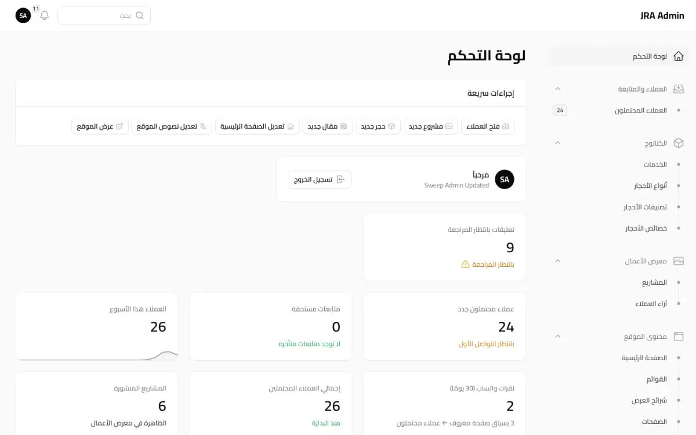

- **إجراءات سريعة**: مشروع جديد، حجر جديد، مقال جديد، الصفحة الرئيسية، نصوص الموقع.
- **المؤشرات**: العملاء الجدد، المتابعات المستحقة، عملاء هذا الأسبوع مقارنة بالأسبوع السابق، نقرات واتساب.
- **الرسوم**: العملاء يوميًا حسب المصدر (30 يومًا)، حسب الخدمة، وأكثر 5 أحجار طلبًا.
- **أحدث العملاء**: غيّر الحالة مباشرة من القائمة.
- **سلامة المحتوى**: ما ينقص الموقع (صور، ترجمات، بيانات تواصل) مع زر **إصلاح** يفتح القائمة المصفّاة.

الأرقام تُحدّث كل 5 دقائق.

## متابعة العملاء المحتملين

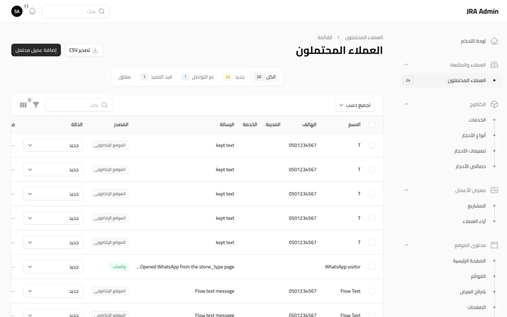

1. **العملاء والمتابعة ← العملاء المحتملون**. التبويبات أعلى الجدول تعرض كل حالة وعددها.
2. من قائمة الإجراءات بجانب كل عميل: **واتساب** أو **اتصال** أو **بريد** مباشرة.
3. افتح العميل لتغيير الحالة، وإسناده لزميل، وتحديد تاريخ متابعة.
4. أضف **ملاحظة** بعد كل تواصل؛ تظهر الملاحظات كخط زمني (الأحدث أولًا).
5. **تصدير CSV** (للمديرين): يُصدّر ما يظهر في الجدول بعد البحث والتصفية.

## إضافة مشروع أو حجر أو خدمة أو مقال

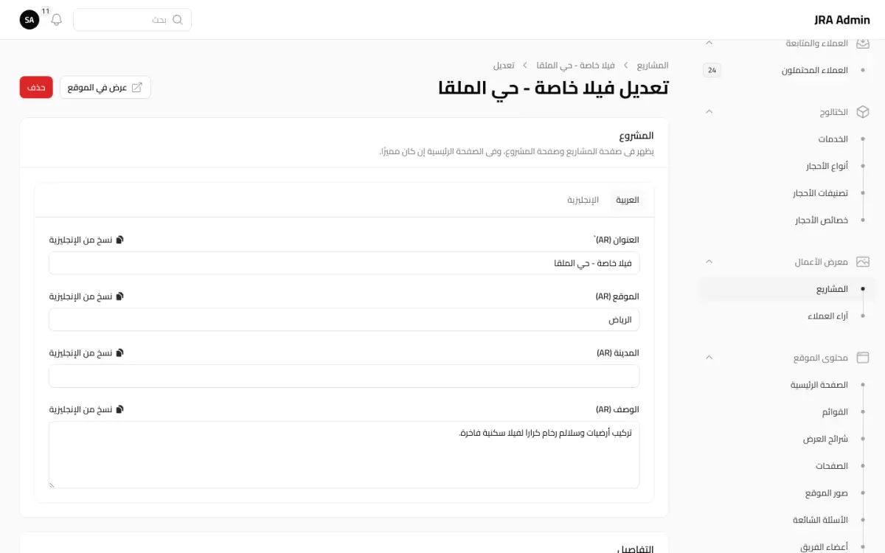

1. افتح القسم (مثلًا **معرض الأعمال ← المشاريع**) ثم **جديد**.
2. اكتب النصوص في تبويب **العربية** ثم **الإنجليزية**. الرقم البرتقالي على التبويب = عدد الحقول المكتوبة في اللغة الأخرى وغير المترجمة هنا. زر **نسخ من العربية/الإنجليزية** بجانب الحقل ينسخ النص لتعديله.
3. **رابط الصفحة** يُملأ تلقائيًا من العنوان الإنجليزي؛ لا تغيّره بعد النشر.
4. **الصور**: المقاس المقترح مكتوب تحت كل حقل. يمكن قص الصورة بالنسبة الصحيحة من زر التحرير. اكتب **وصف الصورة** بالعربية والإنجليزية (لقارئات الشاشة ومحركات البحث). JPG أو PNG أو WebP حتى 5 ميجابايت.
5. صور المعرض: اسحبها لإعادة ترتيبها.
6. **قبل/بعد** في المشاريع: صورتان بنفس الزاوية والمقاس؛ يظهر شريط المقارنة عند رفع الاثنتين.
7. **اسم العميل** لا يظهر إلا بتفعيل «إظهار اسم العميل» وبموافقة العميل.
8. **SEO (اختياري)**: عنوان ووصف مخصصان لنتائج جوجل.
9. احفظ. زر **عرض في الموقع** يفتح الصفحة العامة.

**في الجداول**: اسحب الصفوف لتغيير ترتيب العرض في الموقع؛ **تكرار** ينشئ نسخة غير مفعّلة؛ حدّد عدة صفوف ثم **تفعيل/إيقاف**. المحذوف ينتقل إلى **سلة المحذوفات** (فلتر «المحذوفات») ويمكن **استعادته**؛ الحذف النهائي للمديرين فقط.

**المقالات**: الحالة (مسودة / مجدول / منشور) ظاهرة في الجدول. تاريخ نشر في المستقبل = مقال مجدول. زمن القراءة يظهر تحت النص. يمكن إضافة تصنيف أو وسم جديد من زر «+» دون مغادرة المقال.

**الأحجار**: اختر التشطيبات والألوان والمقاسات والاستخدامات؛ أضف قيمة ناقصة بزر «+». مفتاح **إتاحة ورقة مواصفات PDF** يتحكم في زر التحميل.

## الصفحة الرئيسية

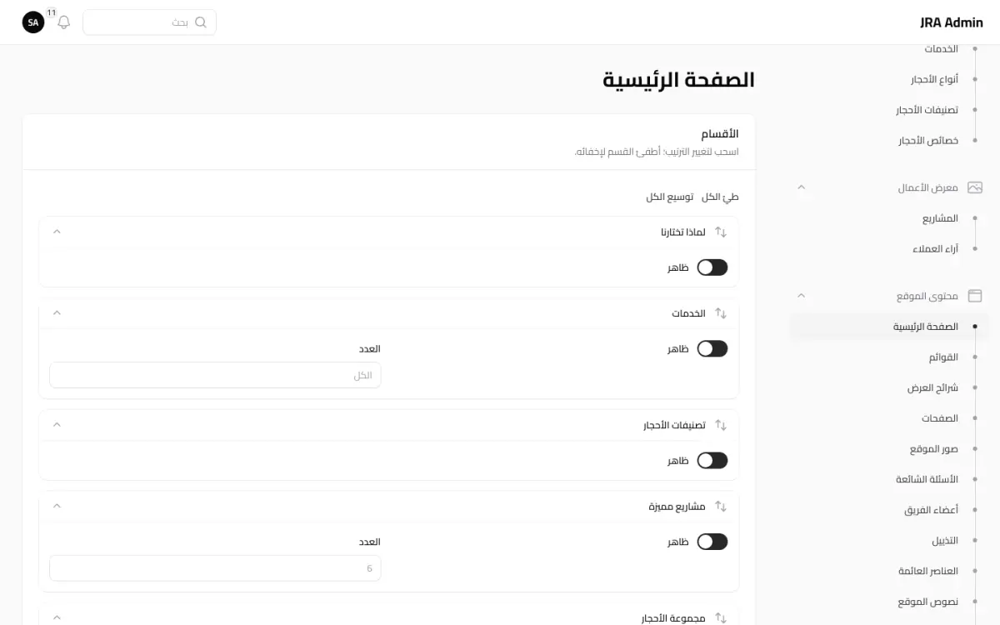

**محتوى الموقع ← الصفحة الرئيسية**:

- **الأقسام**: اسحب لتغيير الترتيب، أطفئ القسم لإخفائه، وحدّد عدد العناصر (المشاريع، الأحجار، الأسئلة).
- **الواجهة**: العنوان والنص عند عدم وجود شرائح، نص الزر ورابطه، قوة التعتيم فوق الصورة، فيديو الرخام، زر واتساب. الشرائح نفسها في **شرائح العرض**.
- كل قسم: عنوانه ووصفه، وبطاقات «لماذا تختارنا» (أيقونة + عنوان + نص)، وخطوات «طريقة عملنا»، وأماكن «التراث في الحجر» (الصور من **صور الموقع**)، وخلفية الدعوة الختامية.
- **الأرقام** تُدخل من **الإعدادات ← الإحصائيات** (أرقام حقيقية فقط).

## القوائم

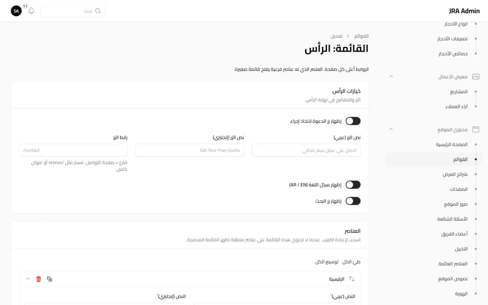

**محتوى الموقع ← القوائم**: الرأس، التذييل، الجوال.

- كل عنصر: النص بالعربية والإنجليزية، ويرتبط بـ **صفحة من الموقع** أو **سجل** (خدمة، حجر، مشروع، مقال، تصنيف) أو **عنوان مخصص** (`/stones?stone_category=marble` أو `https://…`).
- عنصر له **عناصر فرعية**: قائمة منسدلة في الرأس، وعمود في التذييل.
- **خيارات الرأس**: زر الدعوة (النص والرابط)، مبدّل اللغة، زر البحث.
- قائمة **الجوال** فارغة = نفس قائمة الرأس.
- إذا لم يكن في قائمة عناصر مفعّلة تظهر القائمة المدمجة الأصلية.

## الصفحات

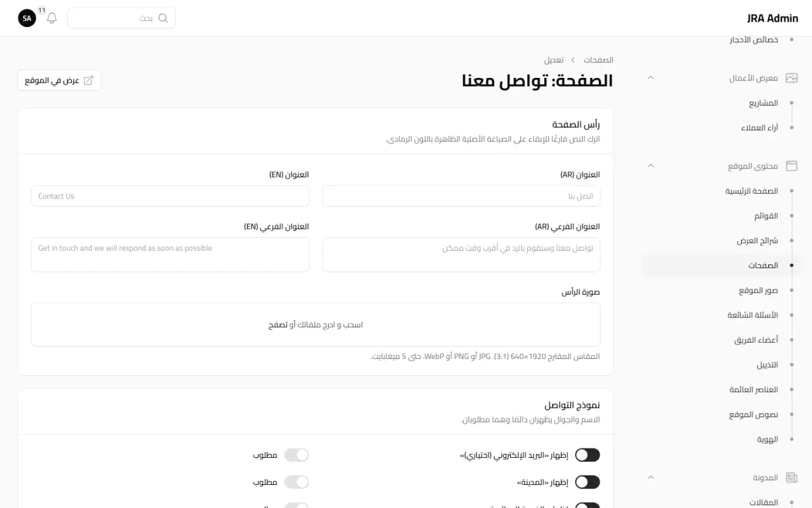

**محتوى الموقع ← الصفحات** (من نحن، تواصل معنا، مقدمات القوائم، صفحة الشكر، 404، الخصوصية، الشروط):

- **رأس الصفحة**: العنوان والعنوان الفرعي وصورة الرأس. الحقل الفارغ يُبقي النص الأصلي (الظاهر بالرمادي).
- **أقسام المحتوى**: نص، صورة ونص، معرض صور، دعوة لاتخاذ إجراء، اقتباس — تظهر في نهاية الصفحة بالترتيب.
- **SEO**: العنوان والوصف وصورة المشاركة، و«إخفاء عن محركات البحث».
- **تواصل معنا**: أظهر/أخفِ حقول النموذج واجعلها مطلوبة (الاسم والجوال مطلوبان دائمًا)، ونص الرسالة بعد الإرسال.
- **من نحن** و**الخصوصية/الشروط**: النصوص الطويلة (للمديرين).

## صور الموقع

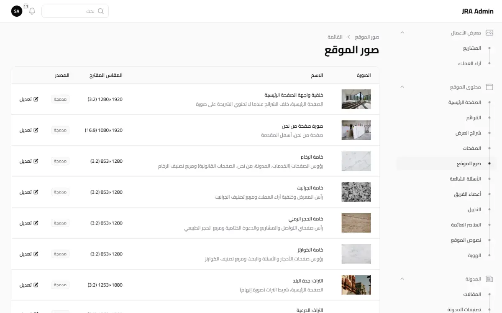

**محتوى الموقع ← صور الموقع**: خلفية الواجهة، صورة من نحن، خامات رؤوس الصفحات، صور التراث، شعار الجوال. كل صورة تعرض مكان استخدامها والمقاس المقترح. **استخدام الصورة المدمجة** يعيد الأصل.

## نصوص الموقع

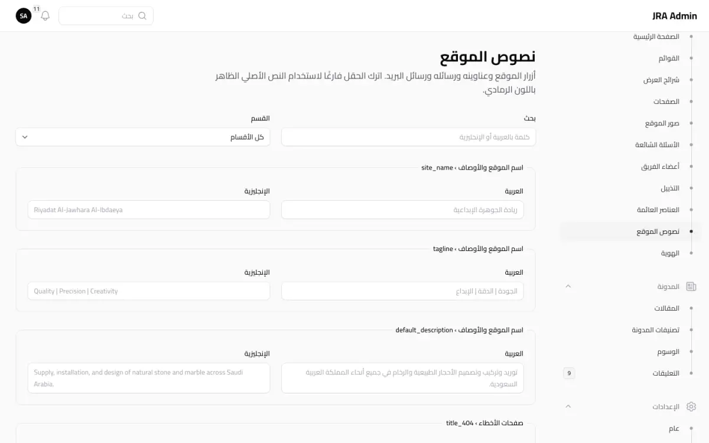

**محتوى الموقع ← نصوص الموقع**: كل أزرار الموقع وعناوينه ورسائله ورسائل البريد، بالعربية والإنجليزية جنبًا إلى جنب.

1. ابحث بكلمة أو اختر القسم.
2. اكتب النص الجديد؛ الحقل الفارغ = النص الأصلي (الظاهر بالرمادي).
3. أبقِ الكلمات التي تبدأ بنقطتين مثل `:name` كما هي — تُستبدل تلقائيًا (اللوحة تمنع الحفظ إن حُذفت).
4. **حفظ نصوص هذه الصفحة**. **استعادة الأصل** يعيد النصين الأصليين.

## الهوية والتذييل والعناصر العائمة

- **الهوية** (للمديرين): اسم الموقع والشعار النصي، الشعاران، أيقونة المتصفح، صورة المشاركة الافتراضية. ألوان الهوية غير قابلة للتعديل عمدًا (مضبوطة للقراءة والتباين).
- **التذييل**: إظهار/إخفاء النص التعريفي وبيانات التواصل وروابط التواصل الاجتماعي وروابط الخصوصية والشروط، وسطر حقوق النشر (اكتب `{year}` مكان السنة). الأعمدة والروابط من **القوائم ← التذييل**.
- **العناصر العائمة**: زر واتساب (إظهار، الموضع، الرسالة، نص الفقاعة)، زر العودة للأعلى، ونصوص شريط ملفات تعريف الارتباط.

## الإعدادات (للمديرين)

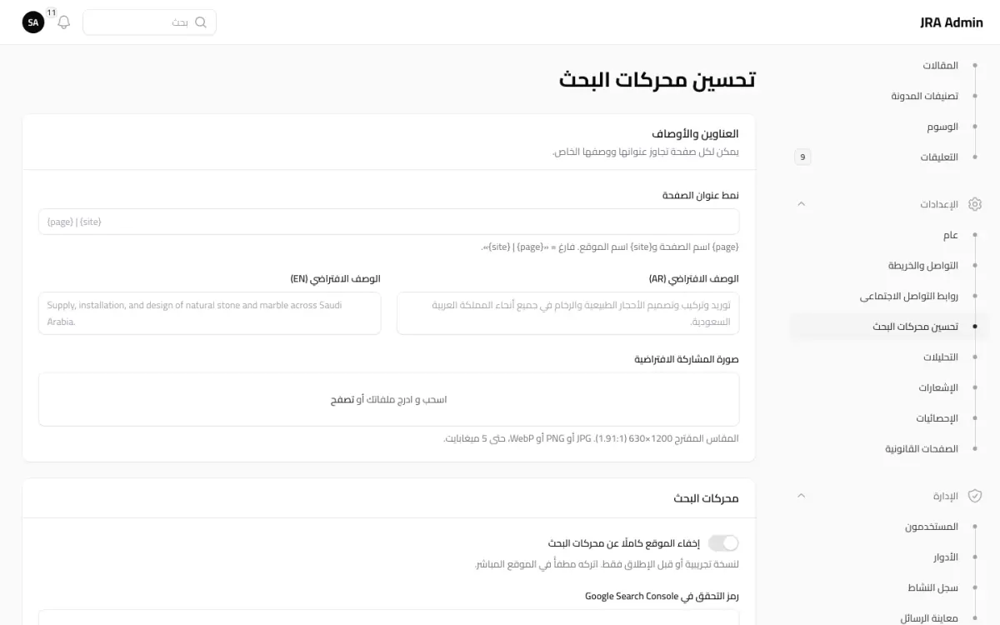

- **عام**: الجوال وواتساب والبريد، ونبذة/رؤية/رسالة.
- **التواصل والخريطة**: العنوان والدوام، الإحداثيات مع معاينة الخريطة، إظهار الخريطة وزر الاتجاهات.
- **روابط التواصل الاجتماعي**.
- **SEO**: نمط عنوان الصفحات (`{page} | {site}`)، الوصف الافتراضي، صورة المشاركة، إخفاء الموقع كاملًا (للنسخة التجريبية فقط)، رموز تحقق Google وBing.
- **التحليلات**: معرّف GA4 أو نطاق Plausible. لا يُحمّل شيء قبل موافقة الزائر.
- **الإشعارات**: بريد إضافي يستلم الطلبات الجديدة، الرد التلقائي ونصوصه، رسائل التعليقات، وقت ملخص المتابعات اليومي.
- **الإحصائيات** و**الصفحات القانونية**.

بيانات البريد (SMTP) ومفاتيح الخادم ليست في اللوحة عمدًا؛ تُضبط في ملف `.env` على الخادم.

## المستخدمون والأدوار (للمديرين)

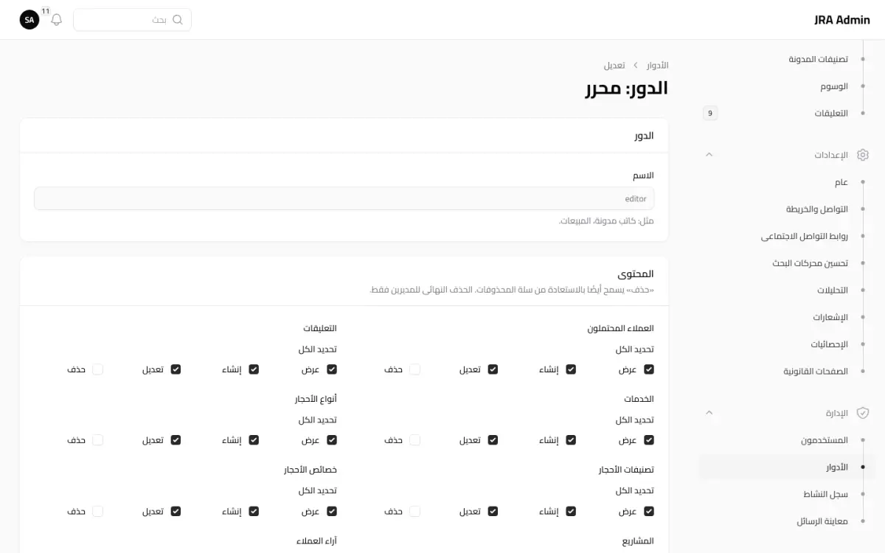

- **الإدارة ← المستخدمون**: إضافة مستخدم وأدواره؛ **إيقاف** الحساب يمنع الدخول فورًا مع بقاء سجله؛ **طلب كلمة مرور جديدة** يُلزمه بتغييرها عند الدخول التالي؛ عمود **آخر تسجيل دخول**.
- **الإدارة ← الأدوار**: أنشئ دورًا (مثل «كاتب مدونة») واختر لكل قسم: عرض، إنشاء، تعديل، حذف، وصلاحيات خاصة (تصدير العملاء، الإعدادات، المستخدمون، سجل النشاط). المدير يملك كل شيء دائمًا؛ دور المحرر يبدأ بما كان يفعله دائمًا (عرض وإنشاء وتعديل دون حذف).
- **سجل النشاط**: من غيّر ماذا ومتى، مع التصفية بالمستخدم ونوع السجل والتاريخ، وعرض القيم قبل/بعد، و**فتح السجل**.

## ملاحظات

- كل محتوى فارغ يعرض النص أو الصورة الأصلية؛ لا يظهر في الموقع حقل فارغ.
- يُحدّث الموقع فورًا بعد الحفظ.
- إذا اختفى قسم أو قائمة بعد تحديث الموقع: تأكد أن أمر `php artisan app:import-site-content` قد شُغّل مرة واحدة (مسؤولية المطوّر).

<!-- english -->

# Admin guide

The panel is at `/admin`. Everything on the public site — texts, images, menus, pages — is edited here in Arabic and English, without code. This guide is also inside the panel: user menu → **Help**.

## Getting started

1. Sign in at `/admin` with your email and password.
2. Admin language: user menu (the circle at the top) → **العربية** or **English**. It is saved for your account.
3. Quick search for a lead, stone, project or article: press `Ctrl + K` (`⌘ + K` on a Mac).
4. Leaving a form with unsaved changes asks for confirmation.

## Dashboard

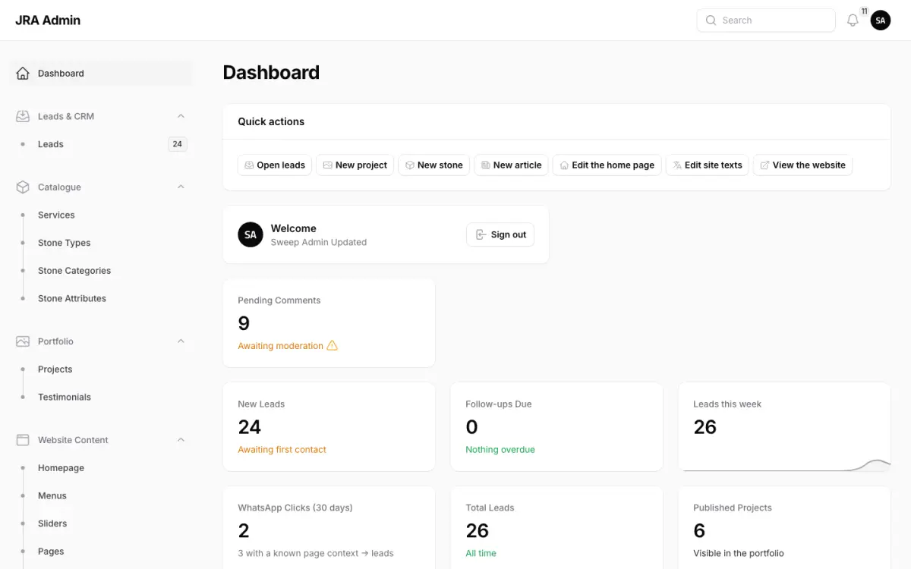

- **Quick actions**: new project, stone or article, the home page, site texts.
- **Figures**: new leads, follow-ups due, leads this week vs the week before, WhatsApp clicks.
- **Charts**: leads per day by source (30 days), leads by service, top 5 stones in requests.
- **Latest leads**: change the status right in the list.
- **Content health**: what the site is missing (images, translations, contact details) with a **Fix** link to the filtered list.

Figures refresh every 5 minutes.

## Following up leads

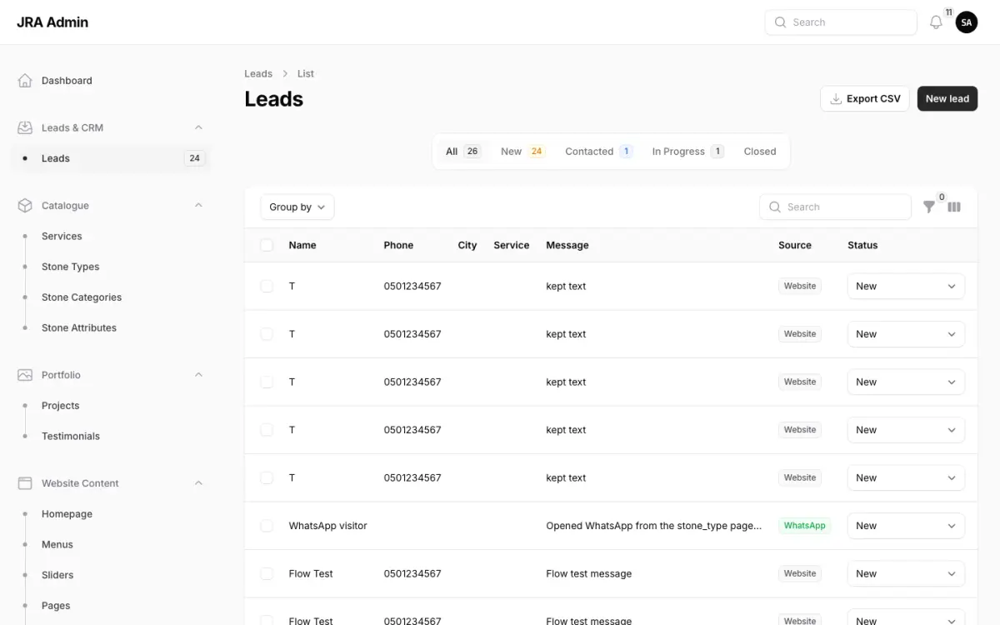

1. **Leads & CRM → Leads**. The tabs above the table show each status with its count.
2. The actions next to a lead: **WhatsApp**, **Call** or **Email** directly.
3. Open a lead to change its status, assign it to a colleague and set a follow-up date.
4. Add a **note** after every contact; notes show as a timeline, newest first.
5. **Export CSV** (admins): exports what the table shows after search and filters.

## Adding a project, stone, service or article

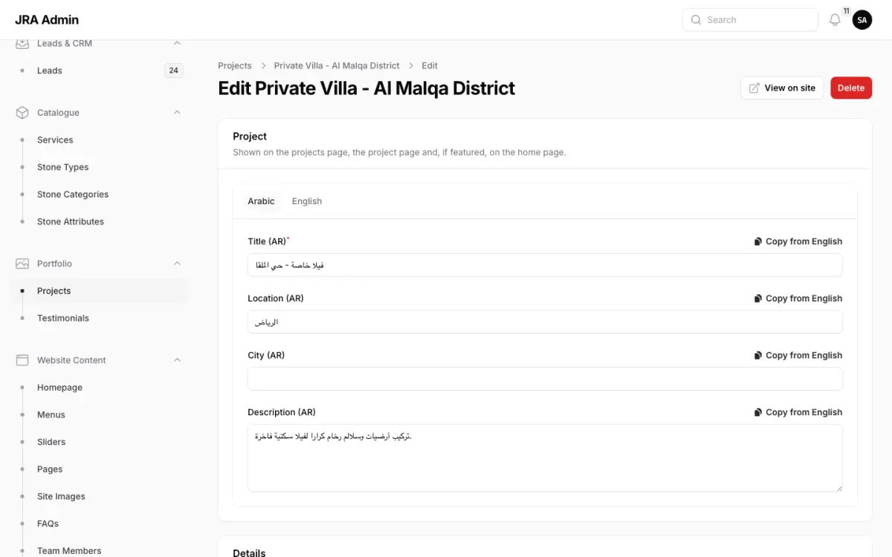

1. Open the section (e.g. **Portfolio → Projects**) and click **New**.
2. Write the texts in the **Arabic** tab, then **English**. The orange number on a tab = fields filled in the other language but not in this one. **Copy from Arabic/English** next to a field copies the text to edit.
3. The **page address** (slug) fills itself from the English title; don't change it after publishing.
4. **Images**: the recommended size is written under each field; crop to the right ratio with the edit button. Fill in the **image description** in both languages (screen readers and search engines). JPG, PNG or WebP up to 5 MB.
5. Gallery images: drag to reorder.
6. **Before / after** (projects): two photos from the same angle and size; the comparison slider shows when both are uploaded.
7. The **client name** only shows with "Show client name" on, and only with the client's permission.
8. **SEO (optional)**: a custom title and description for Google.
9. Save. **View on site** opens the public page.

**In the tables**: drag rows to change the order on the site; **Duplicate** makes an inactive copy; select rows, then **Activate / Deactivate**. Deleted items go to the **trash** (filter "Trashed") and can be **restored**; permanent deletion is for admins only.

**Articles**: the status (draft / scheduled / published) shows in the table; a future publish date schedules the article. Reading time shows under the text. Add a new category or tag with "+" without leaving the article.

**Stones**: pick finishes, colours, sizes and applications; add a missing value with "+". **Offer a PDF spec sheet** controls the download button.

## Home page

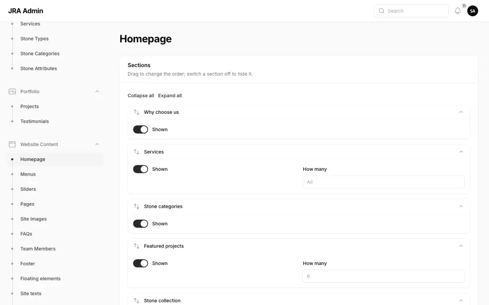

**Website Content → Homepage**:

- **Sections**: drag to reorder, switch a section off to hide it, set how many items (projects, stones, questions).
- **Hero**: heading and text when there are no slides, button text and link, darkening over the photo, marble video, WhatsApp button. The slides themselves are in **Sliders**.
- Each section: its title and subtitle; the "Why choose us" cards (icon, title, text), "How we work" steps, "Heritage in stone" places (photos from **Site images**), and the closing call-to-action background.
- **Statistics** figures are entered in **Settings → Statistics** (real figures only).

## Menus

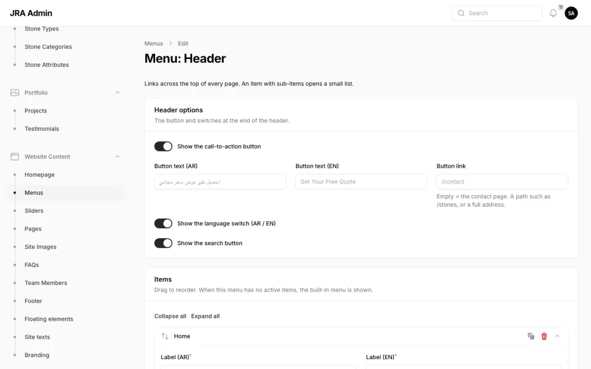

**Website Content → Menus**: Header, Footer, Mobile.

- Each item: label in Arabic and English, linking to a **page of the site**, a **record** (service, stone, project, article, category) or a **custom address** (`/stones?stone_category=marble` or `https://…`).
- An item with **sub-items** becomes a drop-down in the header and a column in the footer.
- **Header options**: the call-to-action button (text, link), the language switch, the search button.
- An empty **Mobile** menu uses the header menu.
- A menu without active items shows the original built-in menu.

## Pages

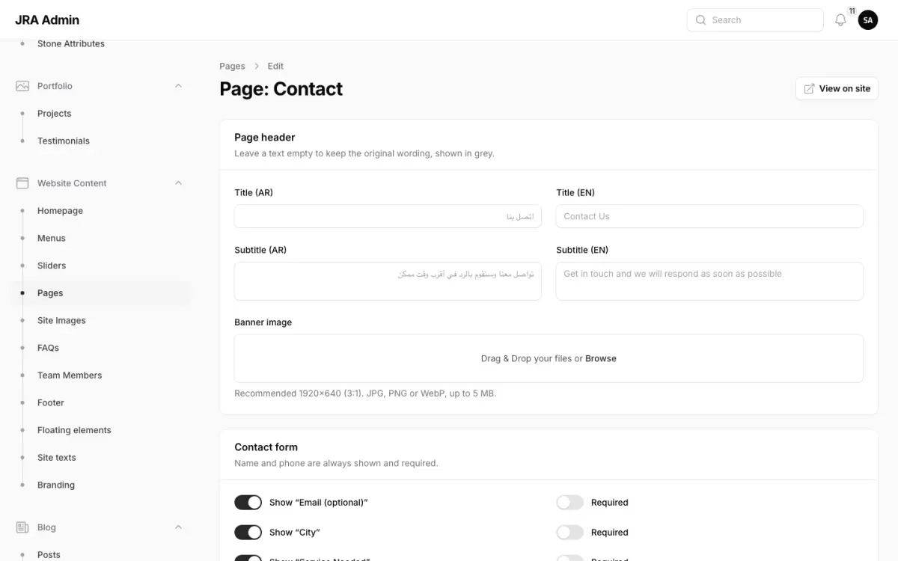

**Website Content → Pages** (About, Contact, list intros, thank-you page, 404, privacy, terms):

- **Page header**: title, subtitle and banner. An empty field keeps the original text (shown in grey).
- **Content blocks**: text, image and text, gallery, call to action, quote — shown at the end of the page in order.
- **SEO**: title, description and share image; "Hide this page from search engines".
- **Contact**: show / hide form fields and make them required (name and phone are always required), and the message after sending.
- **About** and **Privacy / Terms**: the long texts (admins).

## Site images

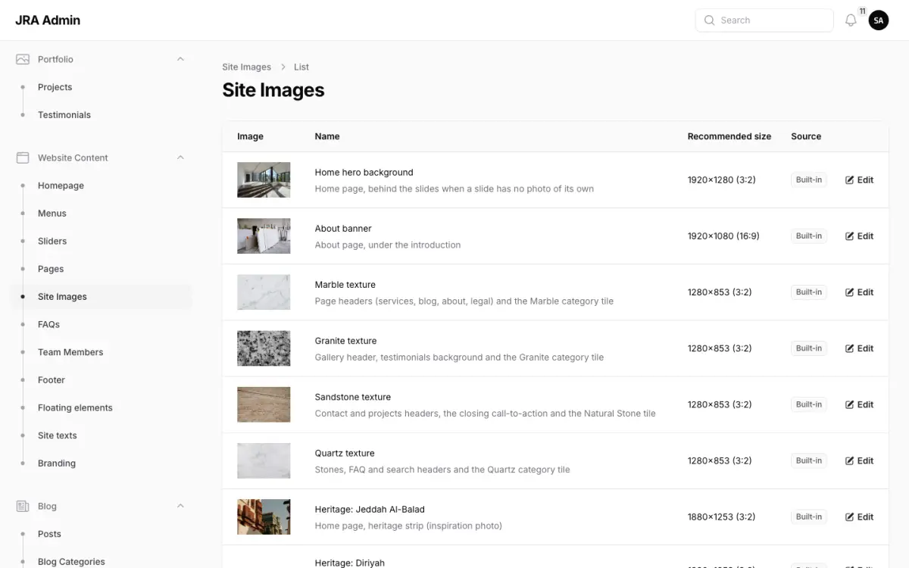

**Website Content → Site images**: hero background, about banner, page-header textures, heritage photos, phone logo. Each shows where it is used and its recommended size. **Use built-in image** goes back to the original.

## Site texts

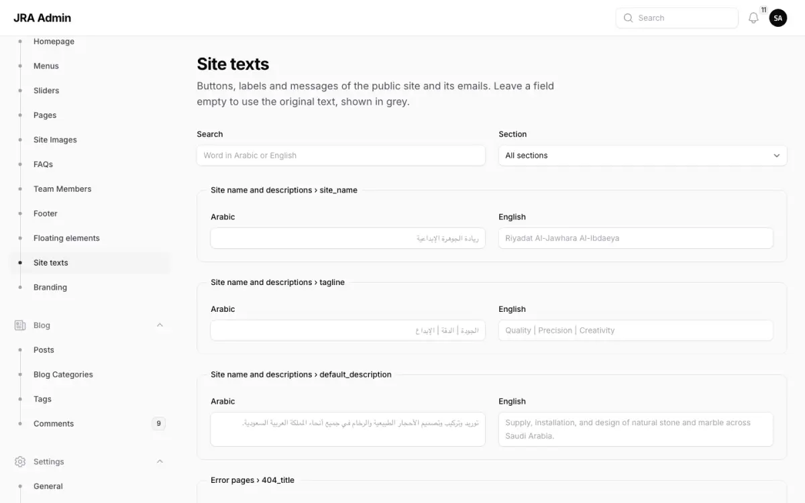

**Website Content → Site texts**: every button, label and message of the site and its emails, Arabic and English side by side.

1. Search for a word or pick a section.
2. Type the new text; an empty field = the original (shown in grey).
3. Keep words starting with a colon such as `:name` exactly as they are — they are filled in automatically (saving is refused if one is removed).
4. **Save texts on this page**. **Restore original** brings back both original texts.

## Branding, footer and floating elements

- **Branding** (admins): site name and tagline, both logos, browser icon, default share image. Brand colours are intentionally not editable (they are tuned for readability and contrast).
- **Footer**: show / hide the about text, contact details, social links and privacy/terms links; the copyright line (write `{year}` for the year). Columns and links come from **Menus → Footer**.
- **Floating elements**: the WhatsApp button (show, position, message, bubble text), the back-to-top button, the cookie banner texts.

## Settings (admins)

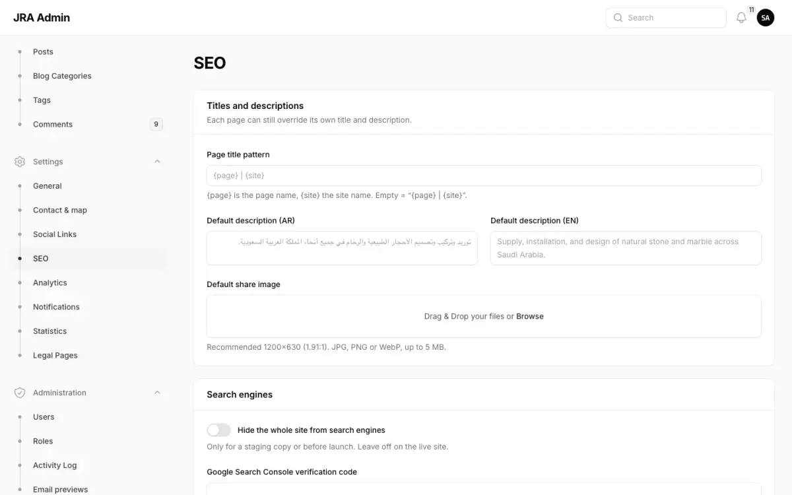

- **General**: phone, WhatsApp, email; about / vision / mission.
- **Contact & map**: address and hours, coordinates with a map preview, show the map and the directions button.
- **Social Links**.
- **SEO**: page title pattern (`{page} | {site}`), default description, share image, hide the whole site (staging only), Google and Bing verification codes.
- **Analytics**: GA4 ID or Plausible domain. Nothing loads before the visitor accepts.
- **Notifications**: extra emails for new requests, the automatic reply and its texts, comment emails, daily follow-up digest time.
- **Statistics** and **Legal Pages**.

Mail server (SMTP) details and server keys are intentionally not in the panel; they are set in the `.env` file on the server.

## Users and roles (admins)

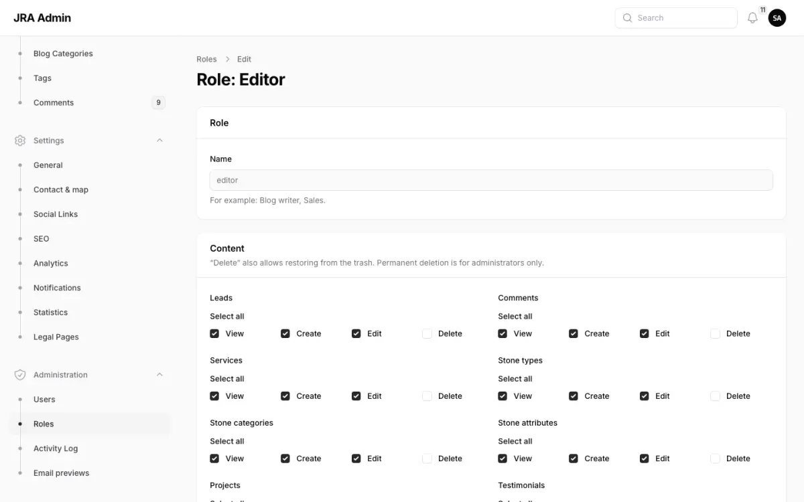

- **Administration → Users**: add a user and their roles; **Deactivate** blocks sign-in immediately and keeps their history; **Ask for a new password** forces a change at the next sign-in; the **Last sign-in** column.
- **Administration → Roles**: create a role (e.g. "Blog writer") and choose per area: view, create, edit, delete, plus special permissions (export leads, settings, users, activity log). Administrators can always do everything; the editor role starts with what editors could always do (view, create and edit, no delete).
- **Activity log**: who changed what and when, filtered by user, record type and date, with before/after values and **Open record**.

## Notes

- Anything left empty shows the original text or image; the site never shows an empty field.
- The site updates right after saving.
- If a section or menu looks unchanged after an update, make sure `php artisan app:import-site-content` was run once (developer task).
